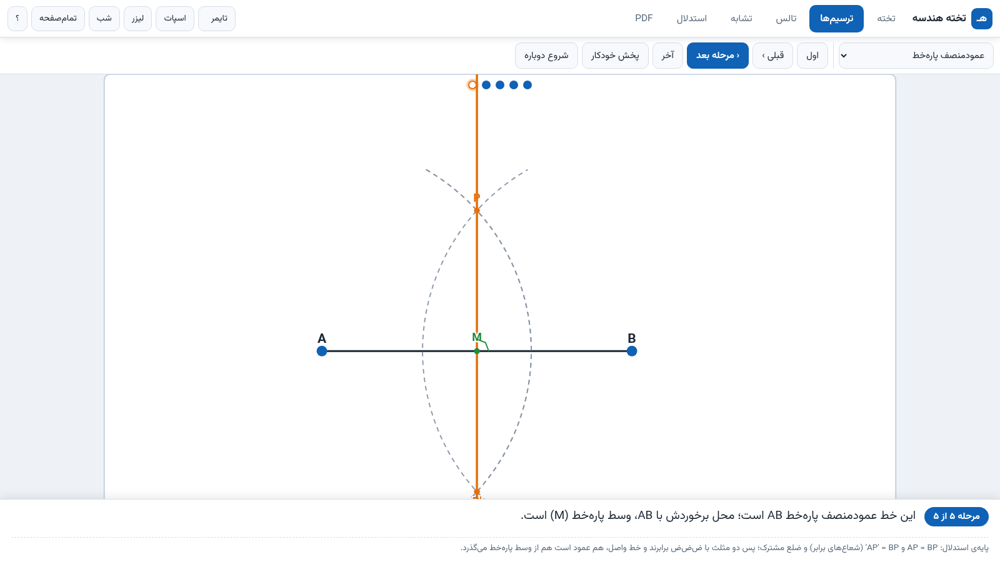
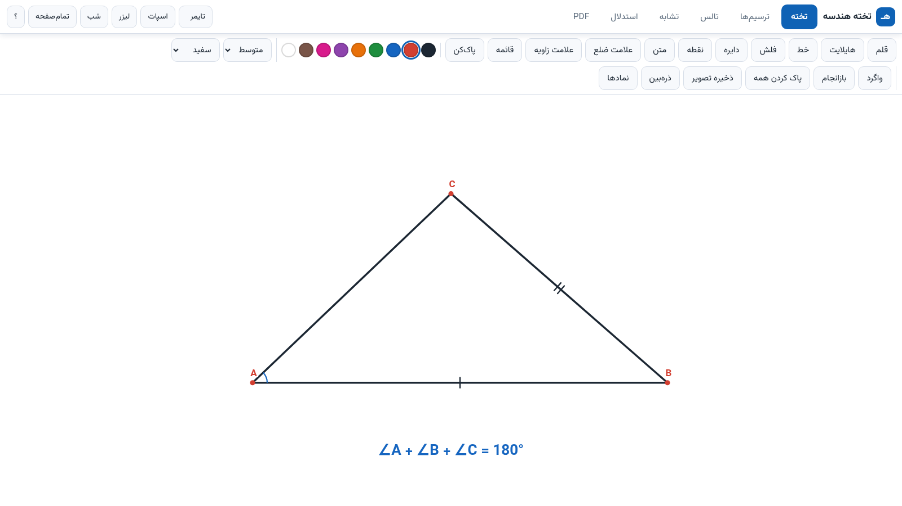
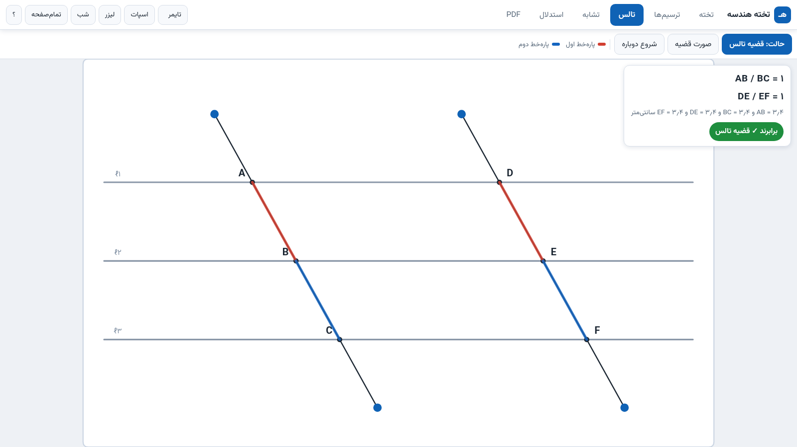
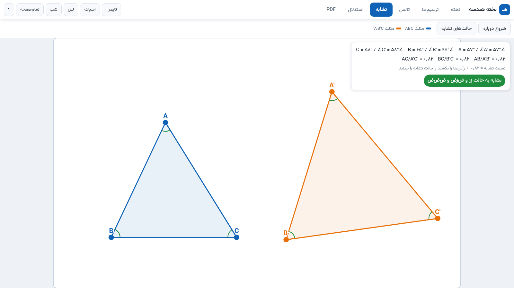

<div align="center">

# 📐 تخته هندسه — Takhte Hendese

**جعبه‌ابزار تعاملی و کاملاً آفلاین برای تدریس هندسه در کلاس درس**

[](#اجرا)
[](#اجرا)
[](#اجرا)
[](#اجرا)
[](LICENSE)

*Interactive offline geometry toolkit for math teachers — built for old classroom PCs and USB sticks.*

</div>

---

<div dir="rtl" align="right">

## چرا این ابزار؟

«تخته هندسه» برای معلم ریاضی ساخته شده که در کلاس درس با **کامپیوتر قدیمی ویندوز ۷**، **بدون اینترنت** و گاهی فقط با یک **فلش USB** سر کلاس است. همه‌چیز در **یک فایل HTML** جمع شده و هیچ نصب، ثبت‌نام یا اتصال شبکه‌ای لازم ندارد؛ فایل `Start.bat` مرورگر موجود (کروم/اج/فایرفاکس) را پیدا می‌کند و برنامه را تمام‌صفحه باز می‌کند. فونت وزیرمتن و موتور PDF هم داخل خود برنامه جاسازی شده‌اند تا روی سیستم مقصد به هیچ چیز خارجی وابسته نباشد.

| ترسیم گام‌به‌گام | تخته هوشمند |
|:---:|:---:|
|  |  |

| قضیه تالس | تشابه مثلث‌ها |
|:---:|:---:|
|  |  |

## امکانات

### ✏️ ترسیم‌های هندسی (خط‌کش و پرگار مجازی)
هفت ترسیم استاندارد کتاب ریاضی نهم **گام‌به‌گام با کمان‌های پرگار**: عمودمنصف، نیمساز زاویه، عمود از نقطه خارج، عمود بر خط، خط موازی، تقسیم پاره‌خط به n قسمت مساوی و رسم مثلث با سه ضلع داده‌شده. هر مرحله با «چرا؟» توضیح داده می‌شود؛ نقاط شکل قابل کشیدن‌اند و همه‌ی کمان‌ها و خط‌ها **زنده بازمحاسبه** می‌شوند. پخش خودکار مراحل و سازگاری با کلیکر ارائه (PageUp/PageDown) هم دارد.

### 🖍️ تخته هوشمند
قلم، هایلایت، خط، فلش، دایره، نقطه‌گذاری با برچسب خودکار (A، B، C و…) و نوشتن متن با پالت نمادهای ریاضی (∠ △ ∥ ⊥ ≅ ∼ √ °). علامت‌های کتاب درسی هم هست: **تیک ضلع** (۱ تا ۳ خط)، **کمان زاویه** و **قائمه**. پاک‌کن با کشیدن، واگرد/بازانجام، زمینه شبکه و نقطه‌ای، ذره‌بین، ذخیره خودکار و خروجی PNG.

### 📏 قضیه تالس و عکس آن
سه خط موازی و دو قطع‌کننده؛ نسبت‌های AB/BC و DE/EF **به‌صورت زنده** با اعداد اعشاری نمایش داده می‌شوند. در حالت «عکس تالس» با کشیدن نقاط روی ضلع‌های مثلث، موازی بودن پاره‌خط آزمایش می‌شود و دکمه «رایاب ≋ قیسه تالس» نسبتی‌ها را یکسان‌سازی می‌کند.

### 🔺 تشابه مثلث‌ها
دو مثلث با رأس‌های قابل کشیدن؛ زاویه‌ها و نسبت اضلاع لحظه‌به‌لحظه به‌روز می‌شود و حالت تشابه (**ز∧ز (AA)، ض∧ز∧ض (SAS)، ض∧ض∧ض (SSS)**) به‌طور خودکار تشخیص داده و نسبت مشابهت نشان داده می‌شود.

### 🧾 استدلال‌ساز
جدول «گزاره | دلیل» برای رسم استدلال هندسی؛ دلایل از فهرست آماده کتاب انتخاب می‌شوند. خروجی چاپ و متن، به‌همراه **کارت قضیه‌ها** (صورت تالس، عکس تالس و حالت‌های تشابه با شکل).

### 📖 نمایش PDF فصل کتاب
باز کردن PDF درس یا هر فایل PDF، زوم، صفحه‌گردی با کلیکر، **قلم و هایلایت روی متن**، معکوس رنگ مخصوص پروژکتور، «صفحه سفید حل تمرین» و ذخیره تصویر صفحه. می‌توانید PDF فصل را داخل برنامه جاسازی کنید (بخش ساخت از سورس).

## اجرا

1. پوشه‌ی `HendeseBoard` را (مثلاً از ریلیز یا کل مخزن) روی فلش کپی کنید
2. روی **`Start.bat`** دوبار کلیک کنید — یا `index.html` را با مرورگر باز کنید
3. تمام! بدون نصب، بدون اینترنت

> پیش‌نیاز: ویندوز ۷ به بعد با Chrome/Edge نسخه ۱۰۹ یا Firefox نسخه ۱۱۵ یا جدیدتر. کل پوشه باید با هم کپی شود (پوشه `pdfjs` موتور نمایش PDF است).

## ساخت از سورس

```bash
python make.py        # سورس‌ها را در index.html یکپارچه می‌کند و HendeseBoard/ + zip می‌سازد
```

سورس ماژولار است: `core.js` (موتور هندسی)، `board.js`، `tarsim.js`، `thales.js`، `tashaboh.js`، `istidlal.js`، `pdfview.js`، `main.js` + `template.html` و `style.css`. فونت وزیرمتن (woff2) هنگام ساخت به‌صورت base64 جاسازی می‌شود.

**جاسازی PDF فصل کتاب** (اختیاری) — فایل `src/book_data.js` را پر کنید و دوباره بسازید:

```python
import base64
data = base64.b64encode(open('fasl.pdf','rb').read()).decode()
open('src/book_data.js','w',encoding='utf-8').write(
    'window.BOOK_DATA = { name: "هندسه ۳ - فصل چهارم", data: "%s" };' % data)
```

## میان‌برها

| کلید | کار | کلید | کار |
|:---:|---|:---:|---|
| `F` | تمام‌صفحه | `T` | تایمر ارائه با زنگ |
| `N` | حالت شب | `M` | ذره‌بین |
| `L` | لیزر | `?` | راهنما |
| `S` | اسپات‌لایت | `Esc` | خروج از ابزارها |
| `PageUp/Down` | کلیکر: مرحله بعد/قبل یا صفحه PDF | `Ctrl+Z/Y` | واگرد/بازانجام در تخته |

## ساختار مخزن

```
├── HendeseBoard/        نسخه‌ی آماده اجرا (همین را روی فلش بریزید)
│   ├── index.html       برنامه‌ی یکپارچه (HTML+CSS+JS+فونت)
│   ├── pdfjs/           موتور PDF (pdf.js legacy 3.11.174)
│   ├── Start.bat        اجراکننده ویندوز
│   └── book_data.js     جای PDF فصل (اختیاری)
├── src/                 سورس ماژولار
├── make.py              اسکریپت ساخت
├── screenshots/         تصاویر پیش‌نمایش
├── LICENSE              مجوز MIT
└── LICENSE-font-Vazirmatn.txt   مجوز SIL OFL فونت وزیرمتن
```

## اعتبارها

- فونت [وزیرمتن](https://github.com/rastikerdar/vazirmatn) — مجوز SIL OFL 1.1
- موتور PDF: [pdf.js](https://github.com/mozilla/pdf.js) (نسخه legacy 3.11.174) — مجوز Apache 2.0
- ساخته‌شده با JavaScript خالص — بدون فریم‌ورک، بدون وابستگی

## مجوز

این پروژه با مجوز [MIT](LICENSE) منتشر شده است.

</div>

---

## English

**Takhte Hendese (Geometry Board)** is a fully offline, interactive toolkit for teaching geometry, designed for classrooms with old Windows 7 PCs, projectors and no internet access. Everything lives in a single HTML file — no installation, no accounts, no network calls. Copy the folder to a USB stick, run `Start.bat`, and teach.

**Modules**

- **Compass & straightedge constructions** — 7 step-by-step constructions (perpendicular bisector, angle bisector, perpendiculars, parallel line, segment division, triangle from SSS) with live recomputation and draggable points
- **Smart whiteboard** — pen, highlighter, shapes, auto-labelled points, math symbol palette (∠ △ ∥ ⊥ ≅ ∼ √ °), side ticks, angle arcs, right-angle marks, eraser-by-stroke, undo/redo, grid/dotted backgrounds, magnifier, PNG export
- **Thales' theorem & converse** — three parallel lines with live ratios (AB/BC = DE/EF), interactive intercept experiment
- **Similar triangles** — drag vertices, auto-detects AA / SAS / SSS similarity and shows the similarity ratio
- **Proof builder** — statement/reason table with the textbook's reason list, print & text export, theorem cards
- **Chapter PDF viewer** — zoom, clicker paging, pen & highlighter annotations, projector color-inversion, blank worksheet mode; optional base64-embedded chapter PDF

**Requirements:** Windows 7+ with Chrome/Edge 109+ or Firefox 115+. Fully offline — Vazirmatn font and pdf.js 3.11.174 (legacy) are embedded.

**Build:** `python make.py` assembles `src/` into the single-file `HendeseBoard/index.html` and packages the portable zip.

**License:** MIT (code) — Vazirmatn font under SIL OFL 1.1, pdf.js under Apache 2.0.
